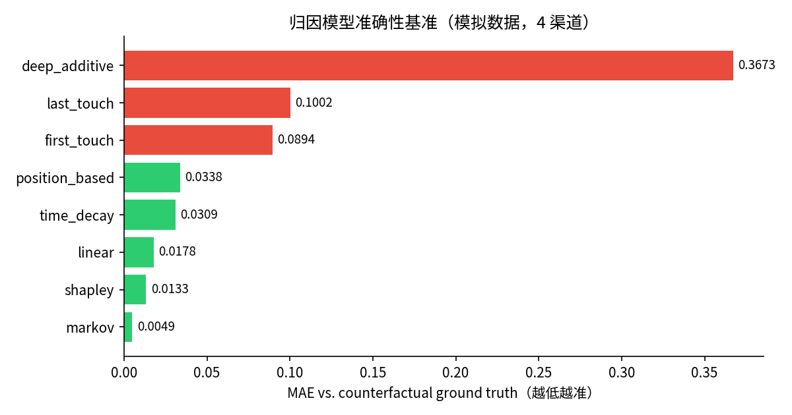
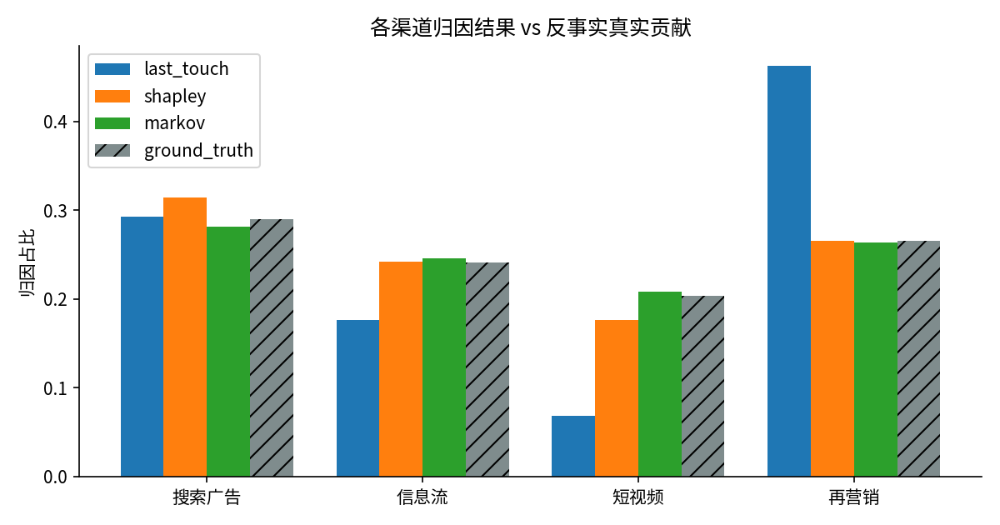

# mta-kit 🎯

**多触点归因（Multi-Touch Attribution）统一算法库 —— 带可验证的因果基准**

[中文](#为什么做这个库) | [English](#why-mta-kit)

---

## 为什么做这个库

GitHub 上的多触点归因代码散落在各个 Jupyter notebook 里，没有统一的接口，  
更没有方法验证算法到底准不准。`mta-kit` 解决两件事：

1. **统一接口**：8 种归因模型，同一个 `attribute(journeys)` API 一行切换
2. **因果基准**：内置带已知因果机制的路径模拟器，用**反事实移除效应**  
   作为 ground truth，可以量化每个归因算法的偏差

## 已内置的模型

| 模型            | 类名                        | `get_model` 名称   | 说明                       |
| ------------- | ------------------------- | ---------------- | ------------------------ |
| 末次触点          | `LastTouch`               | `last_touch`     | 全部功劳归最后一个触点              |
| 首次触点          | `FirstTouch`              | `first_touch`    | 全部功劳归第一个触点               |
| 线性            | `Linear`                  | `linear`         | 功劳均分                     |
| U 型 / 位置      | `PositionBased`           | `position_based` | 首末 40%，中间均分              |
| 时间衰减          | `TimeDecay`               | `time_decay`     | 越近转化权重越高（半衰期可调）          |
| Shapley Value | `ShapleyAttribution`      | `shapley`        | 联盟博弈论；≤12 渠道精确解，更大规模蒙特卡洛 |
| Markov 移除效应   | `MarkovAttribution`       | `markov`         | 一阶马尔可夫链 + Removal Effect |
| 加性深度归因        | `DeepAdditiveAttribution` | `deep_additive`  | 可学习的加性模型，梯度软分配（零深度学习依赖）  |
| Transformer 遮蔽反事实 | `TransformerAttentionAttribution` | `transformer_occlusion` | PyTorch；Transformer 编码器 + 逐触点遮蔽反事实 |

## 真实数据：Criteo Attribution Dataset

内置 [Criteo Attribution Modeling for Bidding](https://huggingface.co/datasets/criteo/criteo-attribution-dataset)
（Diemert et al., AdKDD 2017，CC-BY-NC-SA 4.0）加载器：
16.5M 展示、700 个匿名 campaign 的 30 天真实投放日志。

```bash
python examples/criteo_benchmark.py          # 首次自动下载（623MB，支持 hf-mirror 镜像）
pytest -m criteo                             # 真实数据集成测试（RUN_CRITEO=1 时运行）
```

加载器正确处理了官方数据集最大的坑：**impression 级的 `conversion` 列
不能直接当转化标签**，必须按 `conversion_id` 把用户展示历史重组为
转化前的点击路径（详见 `mta/datasets/criteo.py` 的文档字符串）。

**真实数据初步结果**（150 万行样本、Top-10 campaign，52,428 条转化路径）：

| 模型 | Top-1 渠道占比 | c_other 长尾占比 |
|---|---|---|
| last_touch | 5.12% | 73.14% |
| markov | 5.36% | 72.33% |
| shapley | 5.03% | 73.26% |
| transformer（遮蔽反事实） | 8.45% | 83.94% |

一个诚实的发现：在 Criteo 的**点击路径**上（路径短、触点稀疏），
统计模型（Markov/Shapley）与启发式规则的差异远小于模拟数据——
这本身就是重要结论：**路径信息量不足时，再精巧的归因模型也巧不起来**。
归因差异主要出现在展示级路径或长尾渠道上，这正是 Transformer 模型
集中度明显不同的原因。

## 在线交互演示 🖥️

**[打开交互式演示页面](docs/demo.html)**（纯前端，可部署到 GitHub Pages）——
粘贴任意转化路径数据（或一键生成带真实因果机制的模拟数据），
7 种归因模型即时对比，直观看到"换一个归因模型，预算分配如何被改写"：


## 快速开始

```bash
pip install -e .
python examples/quickstart.py
```

```python
from mta.data import Journey
from mta.models import get_model

journeys = [
    Journey(["搜索广告", "信息流", "再营销"], converted=True),
    Journey(["短视频", "再营销"], converted=True),
    Journey(["搜索广告"], converted=True),
]

model = get_model("shapley")
print(model.attribute(journeys).normalized().to_frame())
```

## 基准测试结果





## MCP Server：让 AI Agent 直接调用归因分析

mta-kit 内置零依赖的 MCP（Model Context Protocol）Server，
Claude Code / Cursor / Claude Desktop 可以直接调用：

```json
{
  "mcpServers": {
    "mta-kit": {
      "command": "python",
      "args": ["-m", "mta.mcp_server"],
      "cwd": "/path/to/mta-kit"
    }
  }
}
```

暴露两个工具：

| 工具 | 功能 |
|---|---|
| `simulate_and_benchmark` | 模拟路径数据，返回 8 种模型的准确性基准 |
| `run_attribution` | 对给定转化路径运行指定归因模型，返回渠道权重 |

配置后你可以直接对 Claude 说："帮我看看这批转化路径用哪个归因模型最合适"。

## 因果基准：评估归因算法的"准头"

模拟器中每个渠道有真实的转化概率参数。评估时将某渠道的致转能力关闭  
重跑模拟，转化率的相对下降即该渠道的**反事实真实贡献**：

```python
from mta.simulator import ChannelSpec, JourneySimulator
from mta.evaluation import benchmark

channels = [
    ChannelSpec("搜索广告", p_convert=0.08, entry_share=0.40),
    ChannelSpec("信息流",   p_convert=0.05, entry_share=0.30),
    ChannelSpec("短视频",   p_convert=0.02, entry_share=0.20),
    ChannelSpec("再营销",   p_convert=0.15, entry_share=0.10),
]
sim = JourneySimulator(channels, seed=2026)
df, _ = sim.generate(20_000)
truth = sim.counterfactual_credit(50_000)

benchmark([...models...], journeys, truth)
```

示例输出（MAE 越低越准）：

```
         model  mae_vs_truth
        markov      0.004914
       shapley      0.013312
        linear      0.017831
    time_decay      0.030902
position_based      0.033755
   first_touch      0.089443
    last_touch      0.100223
 deep_additive      0.367269
```

> 结论：Markov / Shapley 这类因果模型显著优于启发式规则；  
> last_touch 会系统性地高估"临门一脚"渠道（如再营销）、  
> 低估种草渠道（如短视频）——这正是投放预算被错配的经典根源。

## Roadmap

- [x] MCP Server（让 Claude / Cursor 直接调用归因分析）
- [x] README 基准图表自动生成（`examples/make_charts.py`）
- [x] Criteo 真实数据集支持（`mta/datasets/criteo.py`）
- [x] PyTorch Transformer 遮蔽反事实归因
- [ ] 数据驱动的 k 阶 Markov 链与正则化
- [ ] 完整 DNAMMT / RNN 反事实风格深度归因
- [ ] 增量实验（Geo-lift / Holdout）校准模块
- [ ] 效率：Shapley 采样的收敛诊断

---

## Why mta-kit (English)

Attribution code on GitHub lives in scattered notebooks with no unified API
and no way to verify whether a model is actually *right*. **mta-kit** fixes both:

1. **One unified API** — 8 attribution models (heuristic, Shapley Value,
   Markov removal effect, learnable additive deep attribution) behind a single
   `attribute(journeys)` call.
2. **Causal ground truth** — a built-in journey simulator with known channel
   conversion mechanics. It computes each channel's *counterfactual removal
   effect* as ground truth, so you can quantify the bias of every model.

**Key finding** (simulated 4-channel data): Markov (MAE 0.005) and Shapley
(0.013) dramatically outperform heuristic rules; last-touch systematically
over-credits the "closing" channel (retargeting) and under-credits the
"seeding" channels — the classic root cause of misallocated ad budgets.

```python
from mta.data import Journey
from mta.models import get_model

model = get_model("shapley")
result = model.attribute([Journey(["search", "social", "retargeting"], True)])
```

A zero-dependency **MCP server** is included (`python -m mta.mcp_server`) so
coding agents like Claude Code can call attribution analysis directly.

MIT License © 2026

## 开发

```bash
pip install -e ".[dev]"
pytest   # 29 tests
```
